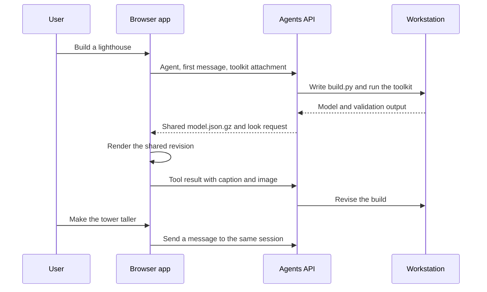

# Creative building with the Agents API

[HoloBricks](https://bricks.hcompany.ai) and [HoloBlocks](https://blocks.hcompany.ai) let you describe a model, watch Holo build it, and ask for changes. Both use the TypeScript `hai-agents` SDK and Holo4 27B.

This walkthrough follows their public implementations. To run an app locally, use its setup guide:

| App | Build toolkit | Setup and source |
| --- | --- | --- |
| HoloBricks | `bricks`: build with LDraw parts and validate part/color pairs | [HoloBricks README](https://github.com/hcompai/holobricks#run-it-yourself) |
| HoloBlocks | `blocks`: build with a block palette and validate the model | [HoloBlocks README](https://github.com/hcompai/holoblocks#run-it-yourself) |

## Try a build

Open either app, sign in, and ask: **"Build a lighthouse on a rocky island."** Keep the tab open while it builds. When it answers, send **"Make the tower taller and add a red roof."** The apps keep the session idle for up to ten minutes after an answer so a follow-up can use the same Workstation and build files.

## Follow the SDK flow

### Start a Workstation with the toolkit

The inline agent declares a `workstation` environment and a custom `look` tool. The first user message carries the build toolkit as a file attachment, created with `fileFromBlob`. Holo installs it on the Workstation, then writes `build.py` and runs the `bricks` or `blocks` command.

HoloBricks uses [`startSession`](https://github.com/hcompai/holobricks/blob/457251512e31981251a9347a706b62e6f628a90f/web/src/agent.ts#L68-L117). HoloBlocks [checks the request size and calls `sessions.createSession`](https://github.com/hcompai/holoblocks/blob/2f8806ee3816b0abe9e24e24ac398cb9916c83f0/web/src/agent.ts#L75-L139). Both set `maxSteps`, `maxTimeS`, and `idleTimeoutS` in the session request.

### Share a revision and return its render

The toolkit checks the build and writes `model.json.gz`. The agent shares that file, then requests `look`. The browser downloads the shared revision and renders it off screen, so Holo's view stays independent of the user's camera.

The [HoloBlocks follower](https://github.com/hcompai/holoblocks/blob/2f8806ee3816b0abe9e24e24ac398cb9916c83f0/web/src/follow.ts) waits for the model to load before answering `look`. It returns a caption and a PNG through [`sendSessionToolResults`](https://github.com/hcompai/holoblocks/blob/2f8806ee3816b0abe9e24e24ac398cb9916c83f0/web/src/agent.ts#L178-L184). Failed renders produce a tool error, allowing the agent to respond or try again.

The browser is part of the agent loop: it supplies the visual feedback. A standalone CLI would also need a renderer and a handler for pending `look` calls.

### Revise or stop the build

A follow-up uses `client.session(id).sendMessage(...)`, so Holo edits the existing build files. The app's Stop action calls `forceAnswer()` to ask for an answer while keeping the session available for follow-ups; `cancelSession({ id })` ends it as interrupted. See the [HoloBlocks session controls](https://github.com/hcompai/holoblocks/blob/2f8806ee3816b0abe9e24e24ac398cb9916c83f0/web/src/agent.ts#L141-L149).

The source links above use fixed public revisions. The app READMEs track current setup requirements, including the renderer assets, toolkit packaging, and sign-in flow.
